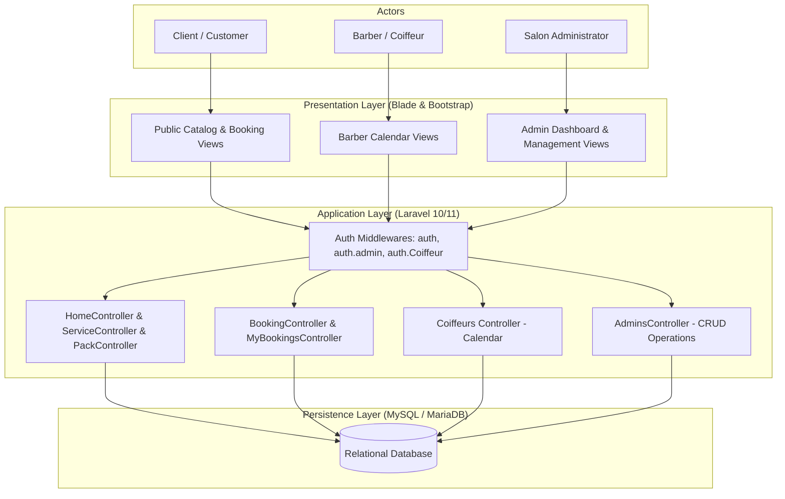

<div align="center">

# BarberShop - Salon & Hairdresser Appointment Booking Platform

**A full-featured Laravel web application for salon appointment scheduling, service and pack catalog management, barber availability calendaring, and multi-role administrative oversight.**

[](https://github.com/trxshi747/Barbershop)
[](https://laravel.com/)
[](https://www.php.net/)
[](https://www.mysql.com/)
[](https://getbootstrap.com/)
[](https://vitejs.dev/)

<br />

<p align="center">
  <a href="#overview">Overview</a> |
  <a href="#video-demonstration">Video Demo</a> |
  <a href="#key-features">Key Features</a> |
  <a href="#role-based-architecture">Role Capabilities</a> |
  <a href="#system-architecture">Architecture</a> |
  <a href="#database-schema">Database Model</a> |
  <a href="#tech-stack">Tech Stack</a> |
  <a href="#getting-started">Getting Started</a> |
  <a href="#repository-structure">Structure</a> |
  <a href="#authors">Authors</a>
</p>

</div>

---

## Overview

**BarberShop** is a modern appointment booking and management platform designed for hair salons and barbershops. Built with the **Laravel** framework, it connects clients, barbers, and salon managers within a cohesive, role-segregated ecosystem.

Clients can browse curated styling services and discounted package bundles, select available dates, book appointments in real time, and proceed through checkout. Barbers have dedicated access to manage their dynamic availability calendar and schedule. Administrators oversee salon operations through a central dashboard managing bookings, staff, service catalogs, and customer feedback.

---

## Video Demonstration

<div align="center">

<video src="https://github.com/trxshi747/Barbershop/raw/master/docs/demo/barbershop-demo.mp4" controls muted width="100%"></video>

[Ouvrir la vidéo en plein écran](docs/demo/barbershop-demo.mp4)

<br />

*Full end-to-end platform demonstration showcasing client reservations, barber calendar scheduling, and administrator oversight.*

</div>

---

## Key Features

### 1. Client Booking Portal
* **Service & Pack Catalog:** Browse individual services (haircut, beard grooming, styling, treatments) and bundled promotional packs.
* **Interactive Appointment Flow:** Date picker, real-time availability checking, and barber selection.
* **Checkout & Booking Confirmation:** Order processing with payment status tracking and success receipt.
* **Customer Dashboard:** Manage personal bookings, review upcoming reservations, and cancel appointments.
* **Community Reviews:** Leave ratings and feedback visible to other clients.

### 2. Barber Workspace
* **Custom Authentication:** Segregated authentication gateway for hairdressers (`/coiffeur/login`).
* **Availability Calendar:** Interactive calendar interface to define, update, or remove working shifts and open slots.
* **Appointment Tracking:** Real-time visibility into assigned appointments and customer bookings.

### 3. Administrative Management Hub
* **Executive Dashboard:** Centralized view of business activity and booking volume.
* **Appointment Scheduling:** View all appointments, assign available barbers to pending bookings, or create walk-in reservations.
* **Service & Pack CRUD:** Create, update, toggle, and delete individual services and promotional package bundles.
* **Staff Management:** Onboard, update, and manage barber profiles.
* **Administrator Accounts:** Full role delegation with administrator CRUD operations.

---

## Role-Based Architecture

The platform enforces three distinct user profiles using dedicated Laravel middlewares:

| Role | Access Route | Authentication Middleware | Primary Responsibilities |
| :--- | :--- | :--- | :--- |
| **Client** | `/booking`, `/my-bookings` | `auth` | Browse catalog, book slots, checkout, view history, leave reviews |
| **Coiffeur (Barber)**| `/coiffeur/calendrier` | `auth.Coiffeur` | Configure availability calendar, view scheduled client sessions |
| **Administrator** | `/admin/index` | `auth.admin` | Full operational oversight, staff & service CRUD, booking assignment |

---

## System Architecture



---

## Database Model

The relational schema coordinates the salon operational workflow:

| Entity / Table | Key Attributes | Relationships |
| :--- | :--- | :--- |
| **users** | `id, name, email, password, role` | One-to-Many with `bookings`, One-to-Many with `feedbacks` |
| **admins** | `id, name, email, password` | Manages services, packs, and coiffeurs |
| **coiffeurs** | `id, name, email, specialite, telephone` | One-to-Many with `disponibilites`, One-to-Many with `bookings` |
| **disponibilites**| `id, coiffeur_id, date, heure_debut, heure_fin` | Belongs to `coiffeurs` |
| **services** | `id, nom, description, prix, duree, image` | Many-to-Many with `bookings`, Many-to-Many with `packs` |
| **packs** | `id, nom, description, prix, image` | Belongs to multiple services |
| **bookings** | `id, user_id, coiffeur_id, date, heure, status` | Belongs to `users`, Belongs to `coiffeurs`, One-to-One with `payments` |
| **payments** | `id, booking_id, montant, methode, status` | Belongs to `bookings` |
| **feedbacks** | `id, user_id, commentaire, rating` | Belongs to `users` |

---

## Tech Stack

| Layer | Technologies |
| :--- | :--- |
| **Backend Framework** | Laravel 10 / 11 (PHP 8.2+) |
| **Architecture** | Model-View-Controller (MVC), Service Architecture, Custom Middlewares |
| **Frontend & UI** | Blade Templating, Bootstrap 4/5, SASS, Custom CSS |
| **Build Tooling** | Vite, NPM |
| **Database** | MySQL / MariaDB (Eloquent ORM, Migrations, Seeders) |
| **Authentication** | Laravel Authentication with multi-guard role separation |

---

## Getting Started

### Prerequisites
* [PHP 8.2+](https://www.php.net/)
* [Composer](https://getcomposer.org/)
* [Node.js & npm](https://nodejs.org/)
* [MySQL / MariaDB](https://www.mysql.com/)

---

### Step-by-Step Installation

1. **Clone the repository:**
   ```bash
   git clone https://github.com/trxshi747/Barbershop.git
   cd Barbershop
   ```

2. **Install backend dependencies:**
   ```bash
   composer install
   ```

3. **Install and compile frontend assets:**
   ```bash
   npm install
   npm run build
   ```

4. **Configure environment:**
   ```bash
   cp .env.example .env
   php artisan key:generate
   ```

5. **Configure database credentials in `.env`:**
   ```env
   DB_CONNECTION=mysql
   DB_HOST=127.0.0.1
   DB_PORT=3306
   DB_DATABASE=barbershop
   DB_USERNAME=root
   DB_PASSWORD=your_password
   ```

6. **Run database migrations:**
   ```bash
   php artisan migrate
   ```

7. **Start the local development server:**
   ```bash
   php artisan serve
   ```
   Open `http://127.0.0.1:8000` in your web browser.

---

## Repository Structure

```
Barbershop/
|-- app/
|   |-- Http/
|   |   |-- Controllers/          # Booking, Services, Packs, Admins, Coiffeurs
|   |   |-- Middleware/           # Role segregation (auth.admin, auth.Coiffeur)
|   |   \-- Requests/             # Form validation requests
|   \-- Models/                   # Eloquent models (Booking, Service, Pack, Coiffeur)
|
|-- config/                       # Application configuration files
|-- database/
|   |-- migrations/               # Database tables and relational schemas
|   \-- seeders/                  # Demo catalog and staff data
|
|-- public/
|   |-- assets/                   # Compiled CSS, SASS, JavaScript, and fonts
|   \-- index.php                 # Application entry point
|
|-- resources/
|   |-- css/ & sass/              # Styling sources
|   |-- js/                       # Client scripts
|   \-- views/                    # Blade templates
|       |-- admins/               # Admin panel (bookings, services, packs, staff)
|       |-- auth/                 # Login and registration templates
|       |-- coiffeurs/            # Hairdresser availability views
|       \-- layouts/              # Main, customer, and admin master layouts
|
|-- routes/
|   \-- web.php                   # All public, client, barber, and admin web routes
|
|-- docs/
|   \-- demo/                     # Video walkthrough demonstration
|-- .env.example                  # Environment template
|-- .gitignore                    # Version control ignore rules
|-- composer.json                 # PHP dependencies
|-- package.json                  # NPM packages
\-- README.md                     # Project documentation
```

---

## Authors

Project developed by:
* **[trxshi747 (Yassir Karrouti)](https://github.com/trxshi747)**
* **Soukaina Sabbar**

